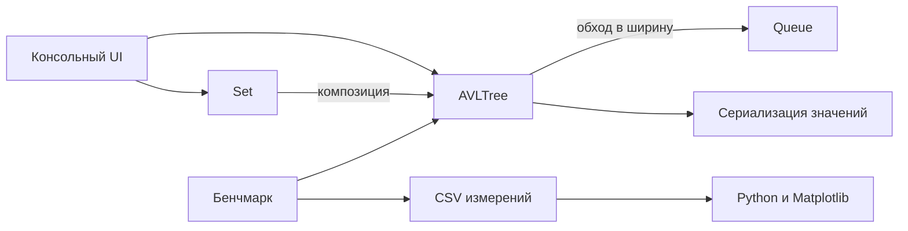
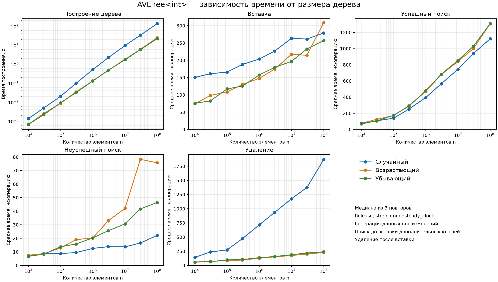

# AVL Tree + Set

**Лабораторная работа №1 по нелинейным структурам данных · C++20**

Обобщённое AVL-дерево и множество на его основе. Поиск, вставка и удаление работают за O(log n). Собственная очередь обеспечивает обход в ширину, а консольное приложение позволяет исследовать операции на целых числах.

[Дизайн](docs/design.md) · [Документация](docs/README.md) · [Консольный UI](docs/console_ui.md) · [Исследование производительности](docs/benchmarks.md)

## Возможности

| Часть проекта | Что поддерживается |
| --- | --- |
| **AVLTree** | уникальные ключи, поиск, вставка, удаление, четыре случая балансировки, копирование и перемещение |
| **Обходы и поддеревья** | шесть DFS-порядков, BFS по уровням, ранняя остановка проверки, извлечение независимой копии поддерева |
| **Set** | объединение, пересечение, разность, включение, равенство и неравенство |
| **Обработка данных** | map, where и reduce для дерева и множества |
| **Сохранение** | сериализация формы и полных значений, восстановление с проверкой BST- и AVL-инвариантов |
| **Типы данных** | числа, строки, Student и пользовательские типы с подходящим сравнением |
| **Проверки** | 63 модульных теста GoogleTest, проверки исключений и граничных случаев |
| **Эксперименты** | замеры на 10⁴–10⁸ элементов, CSV, медианы повторов и графики Matplotlib |

## Быстрый старт

Нужны компилятор C++20, CMake **3.21+** и Ninja. Команды выполняются из корня проекта.

```sh
cmake -S . -B build -G Ninja -DCMAKE_BUILD_TYPE=Debug
cmake --build build --parallel
./build/src/lab_ui
```

GoogleTest используется из установленного пакета. Если пакет отсутствует, CMake скачивает **v1.17.0** через FetchContent с проверкой SHA-256. Для автоматического получения зависимости нужен доступ к сети. Опция `-DBUILD_TESTING=OFF` позволяет собрать приложение и бенчмарк без подключения GoogleTest.

| Цель CMake | Назначение | Исполняемый файл при сборке Ninja |
| --- | --- | --- |
| lab_ui | интерактивная работа с контейнерами | build/src/lab_ui |
| tests | модульные тесты | build/tests/tests |
| bench | измерение производительности | build/benchmarks/bench |

На Windows исполняемые файлы имеют расширение .exe. Для многоконфигурационных генераторов конфигурация задаётся через --config Debug или --config Release, расположение файлов зависит от генератора.

## Консольное приложение

Главное меню предлагает дерево, множества и автоматический демонстрационный пример. UI работает с **int**. Данные сохраняются при переходе между режимами.

Для обоих контейнеров доступны ручное и автоматическое заполнение, вставка, поиск, удаление, вывод, очистка, map, where и reduce. Генератор создаёт уникальные значения в случайном, возрастающем или убывающем порядке.

| Режим | Дополнительные действия |
| --- | --- |
| Дерево | шесть DFS-обходов, BFS, строковая свёртка в выбранном порядке, извлечение поддерева по значению корня |
| Множества | выбор A, B или R, операции A ∪ B, A ∩ B и A ∖ B с записью результата в R, включение и равенство, обмен A и B |
| Сохранение | вывод сериализованной строки, восстановление из строки, запись и чтение файла |

map предлагает прибавление или умножение на число, where — сравнение с границей или отбор чётных значений. Результат заменяет активный контейнер после успешного завершения. Ошибки ввода, восстановления и переполнение преобразования сохраняют прежние данные.

В режиме дерева **команда 23** показывает значения, размер и сериализацию извлечённого поддерева. Автоматический пример демонстрирует балансировку и основные операции на отдельных данных.

[Все команды и сценарии UI](docs/console_ui.md)

## Использование в C++

### Дерево

```cpp
#include "tree/tree_streams.hpp"

#include <iostream>

int main() {
    AVLTree<int> tree;
    for (int value : {4, 2, 6, 1, 3}) {
        tree.insert(value);
    }

    std::cout << tree << '\n';                         // [1, 2, 3, 4, 6]
    if (const auto found = tree.find(3)) {
        std::cout << found->get() << '\n';             // 3
    }

    auto branch = tree.get_subtree(2);
    auto even = tree.where([](const int& value) { return value % 2 == 0; });
    auto doubled = tree.map([](const int& value) { return value * 2; });
    int sum = tree.reduce(0, [](int total, const int& value) {
        return total + value;
    });

    std::cout << branch << '\n';                       // [1, 2, 3]
    std::cout << even << '\n';                         // [2, 4, 6]
    std::cout << doubled << '\n';                      // [2, 4, 6, 8, 12]
    std::cout << sum << '\n';                          // 16

    auto restored = AVLTree<int>::deserialize(tree.serialize());
    std::cout << restored << '\n';                     // [1, 2, 3, 4, 6]
}
```

Заголовок tree/avl_tree.hpp предоставляет контейнер. Отдельный tree/tree_streams.hpp добавляет оператор вывода. Для обходов используются `for_each(TraversalOrder::LKP, visitor)` и `for_each_bfs(visitor)`.

### Множества

```cpp
#include "set/set_streams.hpp"

#include <iostream>

int main() {
    Set<int> a;
    Set<int> b;
    for (int value : {1, 2, 3}) {
        a.insert(value);
    }
    for (int value : {3, 4}) {
        b.insert(value);
    }

    auto combined = a.union_with(b);
    std::cout << combined << '\n';                     // {1, 2, 3, 4}
    std::cout << a.intersection_with(b) << '\n';        // {3}
    std::cout << a.difference(b) << '\n';               // {1, 2}
    std::cout << std::boolalpha << a.is_subset_of(combined) << '\n'; // true

    auto restored = Set<int>::deserialize(combined.serialize());
    std::cout << (restored == combined) << '\n';        // true
}
```

### Контракты данных

| Ситуация | Поведение |
| --- | --- |
| Эквивалентность ключей | определяется Compare через !comp(a, b) и !comp(b, a) |
| Повторная вставка | возвращает false, сохраняет существующую полную запись |
| Отсутствующий ключ | find возвращает nullopt, erase возвращает false, get_subtree выбрасывает std::out_of_range |
| map | сохраняет тип элемента, создаёт новое дерево через вставки |
| Коллизии map | остаётся первый результат в порядке исходного компаратора |
| Объединение и пересечение | совпавший ключ получает полную запись из левого операнда |
| Компаратор результата Set | наследуется от левого операнда, оба исходных компаратора должны задавать одинаковый порядок |
| Равенство Set | определяется ключами независимо от формы дерева и остальных полей записей |
| reduce | у дерева допускает выбор DFS-порядка, у Set всегда использует inorder |
| Обработчик обхода | получает const T& и сохраняет структуру источника и порядок ключей |

Student содержит идентификатор, имя, фамилию, год рождения и среднюю оценку. Его ключом служит id, полное равенство сравнивает все поля. Модель подключается через models/student.hpp, её потоковые операторы — через models/student_streams.hpp.

[Контракты AVLTree](docs/avl/README.md) · [Семантика Set](docs/set.md) · [Обработка элементов](docs/avl/functional_operations.md)

## Архитектура и владение



Корень дерева и дочерние узлы имеют единственного владельца через unique_ptr. Невладеющий доступ использует ссылки, а очередь BFS хранит reference_wrapper на узлы. Копирование создаёт независимые узлы, перемещение передаёт владение.

Set содержит AVLTree и делегирует ему базовые операции. Логика балансировки сосредоточена в дереве. Вывод через << вынесен в отдельные заголовки для дерева и множества.

Для подключения контейнеров в другой проект достаточно добавить лабораторную как подкаталог и выбрать библиотечную цель.

```cmake
add_subdirectory(path/to/NDS_Lab1 nds_lab1)
target_link_libraries(my_app PRIVATE nds_lab1_set)
```

Доступны цели nds_lab1_avl_tree и nds_lab1_set. При таком подключении проект предоставляет библиотеки контейнеров. Требование C++20 и пути к заголовкам передаются потребителям.

## Сериализация

Дерево и Set используют **preorder с маркерами пустых детей**, сохраняя структуру и полные значения.

| Данные | Пример |
| --- | --- |
| Пустая коллекция | `#` |
| Корень 2 с детьми 1 и 3 | `2 1 # # 3 # #` |
| Строковое значение # | `"#" # #` |
| Запись студента | `17 "Ivan" "Petrov" 2005 4.75` |

Строки заключаются в кавычки, кавычки и обратные слеши экранируются. Конечные вещественные числа записываются с точностью для обратного восстановления. При чтении проверяются формат, полнота входа, уникальность, BST-порядок и AVL-баланс.

Восстановление создаёт отдельную коллекцию. При ошибке частичные узлы освобождаются, прежний получатель присваивания сохраняется. Состояние компаратора задаётся при чтении отдельным аргументом.

[Формат, потоковые операции Student и обработка ошибок](docs/serialization.md)

## Тестирование

```sh
cmake --build build --target tests
ctest --test-dir build --output-on-failure
```

Текущий набор содержит **63 теста**. Он покрывает все четыре случая вращений, восстановление нескольких предков после удаления, инварианты дерева, копирование и перемещение, исключения, обходы, поддеревья, функциональные операции, сериализацию, Student, очередь и операции Set.

Для запуска одной группы можно использовать фильтр GoogleTest.

```sh
./build/tests/tests --gtest_filter="Set.*"
```

## Производительность

Выполнен полный Release-прогон на **девяти размерах от 10⁴ до 10⁸ элементов**. Для случайного, возрастающего и убывающего порядков проведено по три повтора. Получены **405 исходных измерений и 135 медиан**.

Измеряются построение, вставка, успешный и неуспешный поиск, удаление. Генерация данных вынесена за границы таймера. Графики показывают время построения всего дерева и среднее время одного вызова в пакете.



Медиана построения дерева из **100 миллионов элементов** на Intel Core i5-11400F, GCC 15.2.0, -O3.

| Порядок ключей | Время |
| --- | --- |
| Случайный | 138,62 с |
| Возрастающий | 24,93 с |
| Убывающий | 22,27 с |

Пиковый RSS процесса составил **4,85 ГиБ**. Неуспешный поиск в этом эксперименте использует ключи выше исходного максимума. Распределения запросов, размеры пакетов и условия машины описаны в отчёте.

[Методика и результаты](docs/benchmarks.md) · [Исходный CSV](benchmarks/results/avl.csv) · [Медианы](benchmarks/results/avl_medians.csv) · [Расход ресурсов](benchmarks/results/avl_resources.txt)

### Собственный прогон

```sh
cmake -S . -B build-release -G Ninja -DCMAKE_BUILD_TYPE=Release -DBUILD_TESTING=OFF
cmake --build build-release --target bench
./build-release/benchmarks/bench benchmarks/results/local.csv 3 10000 30000 100000 300000 1000000 3000000 10000000 30000000 100000000
```

Аргументы задают файл, число повторов и размеры. Запуск без аргументов использует три повтора и размеры до 10⁷. Для полного диапазона до 10⁸ нужен соответствующий запас оперативной памяти.

### Построение графиков

```sh
python3 -m venv build-release/plot-env
build-release/plot-env/bin/python -m pip install -r benchmarks/requirements.txt
build-release/plot-env/bin/python benchmarks/plot_results.py benchmarks/results/local.csv --output benchmarks/results/local.png
```

Скрипт сохраняет PNG и CSV медиан рядом с ним. Matplotlib работает через Agg, поэтому графики можно строить без графического окружения. На Windows Python окружения находится в каталоге Scripts.

## Структура проекта

```text
NDS_Lab1/
├── include/
│   ├── tree/             # avl tree, traversals and stream output
│   ├── set/              # set built on avl tree
│   ├── containers/       # linked queue
│   ├── models/           # student and its stream operators
│   └── serialization/    # shared value encoding
├── src/                  # main menu and container screens
├── tests/                # googletest suites and test utilities
├── benchmarks/
│   ├── benchmark.cpp
│   ├── benchmark_utils.hpp
│   ├── plot_results.py
│   └── results/          # measurements, medians and plots
└── docs/                 # design, contracts and experiment report
```

Объявления и определения шаблонных контейнеров разделены на .hpp и .tpp. Сборка библиотек, UI, тестов и бенчмарка распределена по CMakeLists.txt соответствующих каталогов.

## Документация

| Тема | Где читать |
| --- | --- |
| Постановка задачи, сущности, схемы и требования | [Дизайн](docs/design.md) |
| API дерева, владение и поддеревья | [AVLTree](docs/avl/README.md) |
| Вращения и восстановление баланса | [Схемы вращений](docs/avl/rotations.md) |
| DFS, BFS и ранняя остановка | [Обходы](docs/avl/traversals.md) |
| map, where, reduce и коллизии | [Функциональные операции](docs/avl/functional_operations.md) |
| Правила математических операций | [Set](docs/set.md) |
| Текстовый формат и восстановление | [Сериализация](docs/serialization.md) |
| Меню и пользовательские сценарии | [Консольный UI](docs/console_ui.md) |
| Методика измерений и ограничения памяти | [Бенчмарки](docs/benchmarks.md) |

[Полное оглавление документации](docs/README.md)
