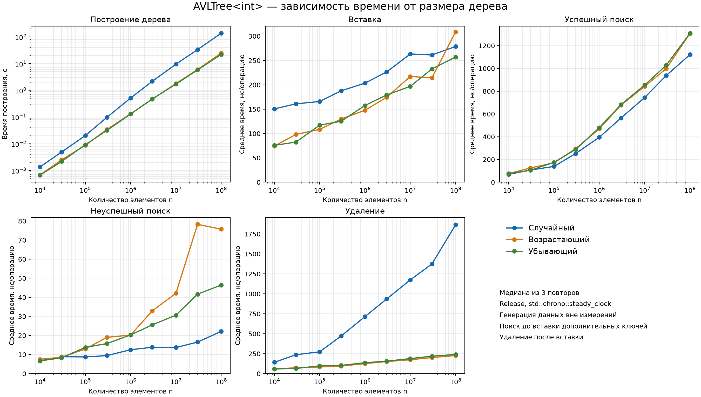

# Исследование производительности AVLTree

## Что измеряется

Исполняемый файл bench измеряет AVLTree<int> через публичные insert, contains и erase. Set делегирует эти базовые операции тому же дереву.

В benchmark.cpp находятся сценарий эксперимента, проверка результатов и запись CSV. benchmark_utils.hpp содержит генерацию входных данных и измерение времени. plot_results.py группирует повторы, вычисляет медианы и строит графики Matplotlib.

Исследуются пять операций и три порядка исходных уникальных ключей. Размеры полного прогона составляют 10 000, 30 000, 100 000, 300 000, 1 000 000, 3 000 000, 10 000 000, 30 000 000 и 100 000 000. Для каждой комбинации размера и порядка выполнены три независимых построения нового дерева.

## Воспроизведение

Команды выполняются из корня репозитория. Для сборки достаточно CMake, Ninja и компилятора C++20.

```sh
cmake -S . -B build-release -G Ninja -DCMAKE_BUILD_TYPE=Release -DBUILD_TESTING=OFF
cmake --build build-release --target bench
./build-release/benchmarks/bench benchmarks/results/avl.csv 3 10000 30000 100000 300000 1000000 3000000 10000000 30000000 100000000
```

Позиционные аргументы bench задают выходной CSV, число повторов и список размеров. Без аргументов используются три повтора и размеры до 10⁷. Полный диапазон до 10⁸ задаётся явно, как в команде выше. Подсказка доступна через --help. При запуске выполняется проверка NDEBUG, чтобы исключить обычную Debug-сборку.

Короткая проверка всей цепочки может использовать меньшие размеры и отдельный файл.

```sh
./build-release/benchmarks/bench /tmp/avl-smoke.csv 1 100 1000
```

Числа должны быть положительными целыми, размер ограничен 100 000 000. Каталог CSV создаётся автоматически. Существующий выходной файл перезаписывается. При ошибке программа возвращает ненулевой код и выводит причину.

Для графиков нужен Python с Matplotlib. Окружение можно разместить внутри игнорируемого каталога сборки.

```sh
python3 -m venv build-release/plot-env
build-release/plot-env/bin/python -m pip install -r benchmarks/requirements.txt
build-release/plot-env/bin/python benchmarks/plot_results.py benchmarks/results/avl.csv --output benchmarks/results/avl.png
```

На Windows исполняемые файлы Python в venv находятся в каталоге Scripts. Для многоконфигурационных генераторов CMake при сборке выбирается --config Release, а путь bench зависит от генератора.

## Сценарий одного повтора

Все векторы создаются до запуска таймера. Исходные ключи — целые числа от 0 до n − 1. Возрастающая последовательность создаётся через iota, убывающая — её разворотом, случайная — shuffle.

Используется mt19937 с seed = 2026 + repeat, где repeat принимает значения 0, 1 и 2 в основном прогоне. Порядок выполнения воспроизводим при том же окружении стандартной библиотеки. Разные реализации shuffle и uniform_int_distribution могут дать другие последовательности между платформами.

Каждый повтор последовательно выполняет следующие этапы.

| Этап | Содержимое пакета | Состояние дерева |
| --- | --- | --- |
| build | n успешных вставок | из пустого до n элементов |
| find_hit | 100 000 запросов существующих ключей | n элементов |
| find_miss | 100 000 запросов отсутствующих ключей | n элементов |
| insert | b = min(n, 10 000) новых ключей | от n до n + b |
| erase | b исходных ключей | от n + b до n |

Поиск использует заранее сгенерированные запросы с возвращением. Успешные ключи равномерно выбираются из [0, n − 1], отсутствующие — из [n, 2n − 1]. Все отсутствующие ключи расположены выше максимального исходного ключа. Они проходят по правой стороне дерева и хорошо прогревают этот путь. Такой сценарий объясняет существенное отличие стоимости неуспешного поиска от равномерного успешного поиска. Результаты относятся к этому распределению запросов.

Вставляемые ключи начинаются с n и гарантированно отсутствуют. Они также подаются в случайном, возрастающем или убывающем порядке, соответствующем набору данных. Удаляются первые b ключей исходного вектора. Для случайного набора это случайная последовательность уникальных исходных ключей, для возрастающего и убывающего — соответствующий край диапазона.

По оси n для удаления указан исходный размер набора. Сам пакет удаления начинается после дополнительных вставок с n + b элементов. Этапы выполняются на одном дереве внутри повтора, поэтому предшествующие операции влияют на форму и состояние кэшей.

## Границы измерений и проверки

measure_ms использует std::chrono::steady_clock и измеряет пакет целиком. Внутри таймера находятся вызовы контейнера, обход входного вектора и накопление числа успешных операций. Выделение памяти под узлы при вставке и освобождение узлов при удалении входят в измерение.

Генерация и перемешивание входных данных, проверки результата, вывод прогресса, запись CSV и уничтожение дерева после повтора выполняются вне измеряемых интервалов.

Количество успешных вставок, поисков и удалений проверяется после каждого пакета. Также проверяется размер дерева после построения и модификаций. Использование результата поиска предотвращает удаление неиспользуемого вычисления оптимизатором. Корректность инвариантов отдельно покрывается модульными тестами, чтобы полный обход дерева не вмешивался в измерения.

Среднее время одной операции вычисляется как длительность пакета, делённая на число операций. Оно включает накладные расходы цикла и различия между операциями внутри пакета. В итоговый график попадает медиана этих средних из трёх повторов.

Для построения график показывает медиану времени построения всего дерева. Это позволяет отдельно увидеть общую стоимость n вставок и стоимость одной операции на уже заполненном контейнере.

## CSV и графики

[avl.csv](../benchmarks/results/avl.csv) содержит 405 исходных измерений, по пять строк для каждого из 81 повтора сценария.

| Столбец | Смысл |
| --- | --- |
| n | исходный размер набора |
| order | random, ascending или descending |
| repeat | номер повтора, начиная с нуля |
| operation | build, insert, find_hit, find_miss или erase |
| operations | количество вызовов в пакете |
| total_ms | длительность пакета в миллисекундах |
| ns_per_operation | среднее время вызова в пакете, в наносекундах |

Python-скрипт проверяет отсутствие повторяющихся измерений и наличие всех операций и порядков для каждого размера. Количество повторов должно совпадать между группами. Затем statistics.median вычисляет центральное значение каждой группы.

[avl_medians.csv](../benchmarks/results/avl_medians.csv) сохраняет 135 медиан, использованных на графике. Построение записано в секундах, остальные операции — в наносекундах на вызов. Этот файл автоматически формируется рядом с PNG.

Matplotlib использует backend Agg, поэтому графики строятся и без графического окружения. PNG содержит пять графиков с одинаковой легендой. Ось размера логарифмическая, ось времени построения также логарифмическая, чтобы размеры 10⁴ и 10⁸ оставались читаемыми. Для остальных операций ось времени линейная и начинается с нуля.



## Среда основного прогона

Полный прогон выполнен 20 ноября 2026 года после освобождения памяти. Все девять размеров измерены заново в одной серии с тем же исполняемым файлом. Графики и таблицы используют результаты этой серии.

- Linux x86_64, Intel Core i5-11400F, 6 физических ядер и 12 логических процессоров
- около 14,6 ГиБ общей оперативной памяти, перед полным прогоном доступно около 8,3 ГиБ
- GCC 15.2.0, Release с -O3 -DNDEBUG и C++20
- один поток измерений, steady_clock, seed 2026 и три повтора
- графики построены Python 3.13.14 и Matplotlib 3.11.2

Запуск выполнялся в обычной рабочей системе. Фоновая нагрузка, частоты CPU, состояние кэшей и аллокатора влияют на результат. Медиана уменьшает влияние единичного выброса. Три повтора дают ориентировочную оценку для этой машины.

## Память и диапазон до 10⁸

В этой сборке sizeof(Node<int>) равен 32 байтам. Входной вектор добавляет 4 байта на элемент. Поэтому нижняя оценка только для узлов и исходного вектора составляет 36n байт.

Отдельное выделение каждого узла имеет дополнительные накладные расходы. При ориентировочно 48 байтах на выделенный узел вместе с метаданными аллокатора получается около 52n байт с входным вектором. Это оценка, фактический расход зависит от аллокатора. Векторы запросов и вставок добавляют менее 1 МБ при стандартных настройках.

| Размер | Узлы и исходный вектор без накладных расходов | Ориентир с накладными расходами |
| --- | --- | --- |
| 10⁶ | 36 МБ | 52 МБ |
| 10⁷ | 360 МБ | 520 МБ |
| 10⁸ | 3,6 ГБ | 5,2 ГБ |

Полный прогон охватывает большие размеры 10⁴–10⁵ и очень большие 10⁶–10⁸, включая дополнительную точку 3×10⁷. Для каждого размера завершены три порядка данных и три повтора. Ранее ограничивавший запуск запас памяти был увеличен перед повторным экспериментом.

Пиковый RSS процесса по /usr/bin/time составил 5 083 256 КиБ, или 4,848 ГиБ. Полное время процесса, включая подготовку и уничтожение деревьев, составило 14 мин 4,36 с. Число major page faults — 0. Остальная память системы не входит в RSS процесса. Показатели ресурсоёмкости сохранены в [avl_resources.txt](../benchmarks/results/avl_resources.txt).

## Полученные результаты

Медиана построения, в секундах.

| Элементов | Случайный | Возрастающий | Убывающий |
| --- | --- | --- | --- |
| 10 000 | 0,001369 | 0,000687 | 0,000676 |
| 30 000 | 0,004951 | 0,002513 | 0,002188 |
| 100 000 | 0,020464 | 0,008822 | 0,009286 |
| 300 000 | 0,098276 | 0,034514 | 0,032004 |
| 1 000 000 | 0,519490 | 0,133298 | 0,130894 |
| 3 000 000 | 2,188733 | 0,470099 | 0,478221 |
| 10 000 000 | 9,580070 | 1,813264 | 1,725979 |
| 30 000 000 | 33,768357 | 6,061516 | 5,855220 |
| 100 000 000 | 138,624081 | 24,930425 | 22,268489 |

При 10⁸ исходных элементов медианы среднего времени операций составили следующие значения, в нс/операцию.

| Операция | Случайный | Возрастающий | Убывающий |
| --- | --- | --- | --- |
| Вставка | 278,81 | 309,00 | 257,19 |
| Успешный поиск | 1121,71 | 1307,87 | 1310,36 |
| Неуспешный поиск | 22,17 | 75,69 | 46,44 |
| Удаление | 1866,18 | 227,14 | 240,10 |

Теоретически построение через n вставок требует O(n log n), а отдельные вставка, поиск и удаление — O(log n). AVL поддерживает эти гарантии и при отсортированном входе.

Измерения показывают более быстрое построение отсортированных наборов в этой реализации. Возможное объяснение — более предсказуемые пути доступа и размещение узлов. Для выделения вклада кэшей, ветвлений и аллокатора требуется отдельное профилирование. Графики показывают фактическую стоимость выбранных сценариев, в которой эти аппаратные эффекты уже присутствуют.

На момент полного прогона набор содержал 57 модульных тестов контейнеров. Все они завершились успешно после измерений.
