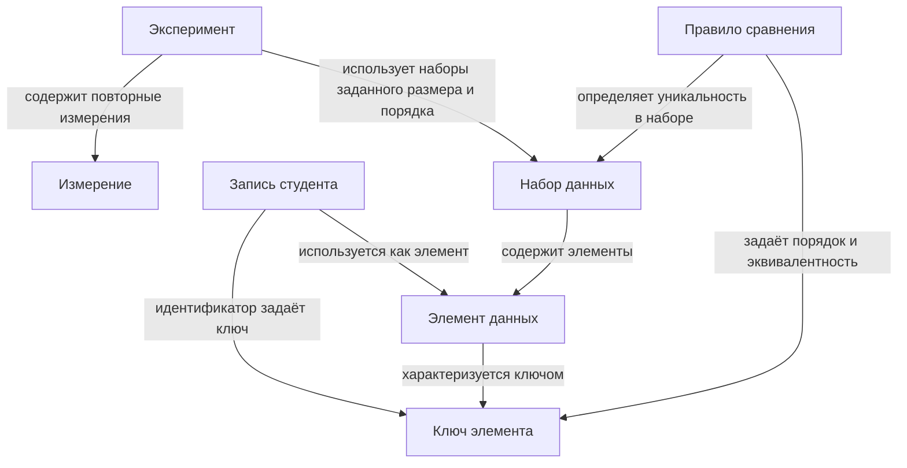
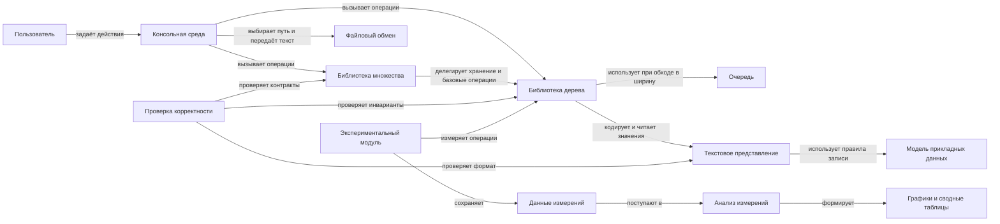

# Дизайн лабораторной работы №1
## Обобщённое AVL-дерево и множество

## 1. Постановка задачи

### 1.1. Идея работы

Требуется разработать систему для хранения и обработки наборов уникальных элементов с задаваемым правилом сравнения. Основой служит самобалансирующееся бинарное дерево поиска. На его основе строится множество с математическими операциями над наборами ключей.

Система объединяет переиспользуемые контейнеры, консольную среду для исследования их поведения, средства сохранения данных и инструменты проверки корректности и производительности.

Контейнеры должны поддерживать числа, строки и составные записи при выполнении требований выбранной операции. Для демонстрации составных данных используется запись студента. Работа с разными типами данных должна опираться на единые правила порядка, уникальности и преобразования.

### 1.2. Назначение

Решение предназначено для задач, в которых необходимо хранить уникальные данные, быстро проверять принадлежность, добавлять и удалять записи, получать упорядоченные последовательности и сопоставлять несколько наборов.

Примеры применения включают поиск записей по идентификатору, исключение повторов при объединении источников, выделение общих записей, фильтрацию и вычисление сводных значений. Наборы студентов служат примером таких данных.

В учебной работе система позволяет наблюдать последствия вставок и удалений, сопоставлять способы обхода и исследовать зависимость времени операций от размера и порядка входных данных. Библиотечная часть должна быть пригодна для использования в последующих лабораторных работах.

### 1.3. Объём решения

В объём входят базовые операции дерева с AVL-балансировкой, шесть обходов в глубину и обход в ширину, преобразование, фильтрация, свёртка, независимое копирование, извлечение поддерева, сохранение и восстановление.

Для множества предусматриваются базовые операции, объединение, пересечение, разность, проверка включения и равенства, преобразование, фильтрация, свёртка и сохранение данных.

Консольная среда предназначена для работы с целыми числами. Переиспользуемые контейнеры допускают другие типы. Предусматриваются ручной ввод, генерация данных и автоматические примеры.

## 2. Сущности прикладной задачи

### 2.1. Понятия и ограничения

Предметная задача рассматривается как обработка наборов данных с определяемой пользователем идентичностью элементов.

| Сущность | Описание |
| --- | --- |
| Набор данных | Совокупность элементов, поддерживаемая пользователем или участвующая в эксперименте. В хранимой коллекции каждому эквивалентному ключу соответствует один представитель |
| Элемент данных | Полное значение, которое хранится, проверяется, преобразуется и передаётся в результат операции |
| Ключ элемента | Информация, определяющая его место в порядке и эквивалентность другим элементам. Для числа ключом может быть само значение, для студента — идентификатор |
| Правило сравнения | Отношение, задающее порядок и эквивалентность ключей. Оно определяет смысл уникальности в конкретном наборе |
| Запись студента | Составной элемент с идентификатором, именем, фамилией, годом рождения и средней оценкой |
| Эксперимент | План измерения выбранных операций на наборах заданного размера и порядка с заданным числом повторов |
| Измерение | Результат одного запуска измеряемой операции или пакета операций с указанием условий и длительности |

Структурная эквивалентность ключей задаётся правилом сравнения. Значения a и b эквивалентны, когда a не предшествует b и b не предшествует a. Правило должно задавать строгий слабый порядок и сохранять его во время работы с коллекцией.

У студента идентификатор определяет ключ. Два студента с одинаковым идентификатором могут различаться именем, годом рождения и оценкой, но представляют один ключ множества. Полное равенство записей сравнивает все поля.

Для сохраняемой записи студента идентификатор должен быть положительным, а оценка — конечным числом. Имена могут содержать пробелы и специальные символы. Конкретная шкала оценок и допустимый диапазон годов определяются прикладным использованием.

### 2.2. Связи сущностей

Операция над двумя наборами различает левый и правый операнды. Это определяет направление разности, источник настройки сравнения и выбор полной записи при совпадении ключей.

## 3. Архитектура системы

### 3.1. Высокоуровневые компоненты

| Компонент | Ответственность |
| --- | --- |
| Консольная среда | Взаимодействие с пользователем, выбор режима, управление текущими данными, запуск действий и отображение ошибок |
| Библиотека дерева | Упорядоченное хранение, поиск, изменение, балансировка, обходы, преобразования и работа с поддеревьями |
| Библиотека множества | Математические операции и контракты уникальности поверх дерева |
| Поддержка обхода в ширину | Очередь ожидающих обработки элементов с порядком поступления |
| Модель прикладных данных | Описание составной записи студента и правил её сравнения |
| Текстовое представление | Преобразование значений в текст и обратно, правила экранирования и контроль корректности |
| Файловый обмен | Чтение и запись текстовых данных по выбранному пользователем пути |
| Проверка корректности | Проверка результатов операций, инвариантов, граничных случаев и поведения при ошибках |
| Экспериментальный модуль | Подготовка наборов, измерение операций и сохранение исходных результатов |
| Анализ измерений | Группировка повторов, вычисление медиан и построение графиков |

### 3.2. Связи компонентов

Множество содержит дерево и использует его операции. Такое отношение позволяет поддерживать балансировку и управление содержимым в одном компоненте.

Библиотеки предоставляют операции независимо от консольной среды и экспериментального модуля. Отображение и файловый обмен подключаются на уровне использования контейнера. Правила представления конкретного типа данных отделяются от структуры хранения.

### 3.3. Дерево поиска и балансировка

Выбирается AVL-дерево. Каждый его узел содержит один элемент и имеет левое и правое поддеревья. Все ключи левого поддерева предшествуют ключу корня, все ключи правого следуют за ним по выбранному сравнению.

Высота пустого дерева равна нулю, высота листа — единице. Высота непустого поддерева равна единице плюс максимум высот детей. Разность высот левого и правого поддеревьев каждого узла должна принадлежать множеству −1, 0, 1.

AVL-баланс ограничивает длину пути поиска логарифмом числа элементов. Это обеспечивает предсказуемую сложность базовых операций, в том числе для возрастающего и убывающего входа.

Поиск на каждом шаге выбирает одно из поддеревьев по сравнению ключей. Вставка использует тот же путь и добавляет элемент при достижении свободного места. При обнаружении эквивалентного ключа сохраняется существующее полное значение.

Удаление рассматривает узел без детей, с одним ребёнком и с двумя детьми. В последнем случае место удаляемого узла занимает следующий по порядку элемент из правого поддерева. Оставшиеся элементы сохраняют свои значения.

После вставки и удаления высоты и баланс проверяются вдоль затронутого пути к корню. Нарушения исправляются одиночным или двойным вращением. Вращение сохраняет порядок ключей и состав элементов, меняя форму локального поддерева. После удаления восстановление может потребоваться у нескольких предков.

### 3.4. Обходы и обработка элементов

Для DFS используются шесть перестановок действий над корнем, левым и правым поддеревьями. Общий механизм выбирает первое поддерево и момент обработки корня. Рекурсивный обход соответствует структуре дерева, а AVL-баланс ограничивает глубину обработки.

Для BFS используется очередь. Сначала в неё помещается корень. После обработки очередного узла его левый и правый дети добавляются в конец. Порядок поступления обеспечивает посещение уровней сверху вниз и слева направо.

Обход передаёт обработчику доступ для чтения к каждому значению. Обработчик обязан сохранять структуру исходного контейнера и порядок ключей.

Проверка выполнения условия для всех элементов использует обход с ранней остановкой. Если условие нарушено, оставшиеся ветви пропускаются. Это решение применяется при проверке включения множества.

### 3.5. Преобразование, фильтрация и свёртка

map создаёт новую коллекцию того же типа элементов с тем же правилом сравнения. Исходные значения обрабатываются в порядке сравнения. Каждый преобразованный элемент вставляется по обычным правилам дерева.

Произвольное преобразование может менять порядок ключей и создавать эквивалентные результаты. Повторная вставка поддерживает корректность дерева. При коллизии остаётся первый преобразованный элемент в порядке обработки исходной коллекции. При возрастающем сравнении это запись с меньшим исходным ключом, при убывающем — с большим числовым ключом.

Для map выбирается inorder, который требует памяти, пропорциональной высоте дерева, и задаёт определённый порядок вызовов. Обход в ширину может сократить число вращений для преобразований, сохраняющих порядок, но требует памяти, пропорциональной ширине дерева. Произвольный map должен сохранять корректность при любом допустимом преобразовании.

where создаёт независимую коллекцию из элементов, прошедших предикат. reduce последовательно объединяет текущий аккумулятор с очередным элементом. Порядок является частью контракта свёртки, поскольку операция может быть некоммутативной.

### 3.6. Операции множества

Объединение начинает с независимой копии большего множества и добавляет элементы меньшего. При равенстве размеров копируется левое. Результат получает правило сравнения левого операнда даже при копировании большего правого дерева. При совпадении ключей полная запись выбирается из левого множества.

Пересечение обходит меньшее множество и проверяет наличие каждого ключа в другом. В результат включается соответствующая левая запись. Это правило сохраняется и при обходе правого множества.

Разность обходит левое множество и включает ключи, отсутствующие в правом. Проверка включения сначала сравнивает размеры, затем проверяет принадлежность с остановкой при первом отсутствующем ключе.

Для равенства достаточно совпадения размеров и включения в одну сторону. Равенство определяется ключами. Полные записи результата объединения и пересечения могут зависеть от порядка операндов при одинаковом наборе ключей.

Бинарные операции предполагают, что оба экземпляра правила сравнения задают один порядок и эквивалентность. Ответственность за совместимость лежит на вызывающей стороне.

### 3.7. Независимость результатов и извлечение поддерева

Копия коллекции должна содержать независимые элементы хранения и сохранять значения и правило сравнения. Изменение копии должно быть безопасно для источника. Передача содержимого оставляет источник пустым и пригодным к дальнейшей работе.

Извлечение поддерева выполняет поиск выбранного корня, затем создаёт независимую копию найденного узла и всех его потомков с сохранением формы. Поддерево корректного AVL само удовлетворяет требованиям порядка и баланса. Если выбран весь корень, результат представляет независимую копию всего дерева.

### 3.8. Сохранение и восстановление

Выбирается текстовое представление с фиксированным preorder и явным обозначением пустых дочерних связей. Такое описание позволяет сохранить значения вместе с формой дерева. Формат дерева используется и для множества.

Кодирование одного значения определяется его типом. Для строк предусматриваются кавычки и экранирование, для составных записей — согласованный порядок полей. Числа должны сохраняться с точностью, достаточной для обратного восстановления. Числовое представление должно быть согласовано между записью и чтением.

Восстановление строит отдельный результат с заданным правилом сравнения. Проверяются границы значений, полнота структуры, отсутствие лишних данных, ограничения порядка от всех предков, уникальность ключей и AVL-баланс. Высоты и размер выводятся из восстановленной структуры.

Некорректные данные приводят к ошибке восстановления. Частичный результат освобождается. Ограничение допустимой глубины чтения должно отклонять заведомо невозможные для AVL структуры до исчерпания стека обработки.

## 4. Функциональные требования

Идентификаторы требований используются для сопоставления поведения системы и приёмочных сценариев.

### 4.1. Общие операции коллекций

| Требование | Действие и ожидаемое поведение |
| --- | --- |
| F-01 | Создать пустое дерево или множество с выбранным правилом сравнения |
| F-02 | Добавить элемент. Для нового ключа увеличить размер на единицу, для эквивалентного ключа сообщить об отсутствии вставки и сохранить существующую запись |
| F-03 | Проверить принадлежность или получить полное хранимое значение по эквивалентному ключу. Отсутствие ключа должно быть явно различимо |
| F-04 | Удалить ключ и сообщить результат. Удаление отсутствующего ключа сохраняет коллекцию |
| F-05 | Получить число элементов и признак пустоты |
| F-06 | Очистить коллекцию. Повторная очистка пустой коллекции допустима |
| F-07 | Создать независимую копию коллекции. Если копирование завершается ошибкой, источник и получатель присваивания сохраняют прежнее состояние |
| F-08 | Передать содержимое коллекции другому владельцу. После успеха источник пуст и допускает новые операции. Самоприсваивание сохраняет данные |
| F-09 | Предоставлять значения для чтения с сохранением порядка ключей. Срок доступности полученного значения ограничен временем жизни соответствующего элемента |

### 4.2. Операции дерева

| Требование | Действие и особые сценарии |
| --- | --- |
| F-10 | После каждой успешной вставки и удаления сохранять порядок поиска, AVL-баланс, корректность высот и точное число узлов |
| F-11 | Выполнить выбранный DFS-обход КЛП, КПЛ, ЛПК, ЛКП, ПЛК или ПКЛ. Каждый элемент посещается один раз |
| F-12 | Выполнить BFS по уровням слева направо |
| F-13 | Для пустого дерева завершить обход без вызова обработчика. Некорректный выбор DFS-порядка должен быть отклонён |
| F-14 | Извлечь независимую копию поддерева по ключу его корня с сохранением структуры и правила сравнения |
| F-15 | При отсутствии корня извлекаемого поддерева сообщить об ошибке поиска и сохранить исходное дерево |
| F-16 | Прекратить проверку общего условия при первом элементе, который ему не удовлетворяет. Для пустого дерева считать условие выполненным |

### 4.3. Функциональная обработка

| Требование | Действие и особые сценарии |
| --- | --- |
| F-17 | map преобразует все значения в новую коллекцию того же типа элементов с сохранением исходного правила сравнения |
| F-18 | При совпадении преобразованных ключей map сохраняет полное значение первого результата в порядке исходного сравнения. Число элементов результата может уменьшиться |
| F-19 | where создаёт независимую коллекцию из элементов, для которых предикат истинен |
| F-20 | reduce возвращает свёртку элементов с явно заданным начальным аккумулятором. Тип результата может отличаться от типа элемента |
| F-21 | Для дерева reduce допускает выбор DFS-порядка, по умолчанию используется ЛКП. Для множества порядок фиксирован сравнением ключей |
| F-22 | На пустой коллекции map и where дают пустой результат, reduce возвращает начальный аккумулятор. Обработчики не вызываются |
| F-23 | Ошибка обработчика прерывает операцию. Исходная коллекция сохраняет состояние при соблюдении контракта обработчика. Внешние действия обработчика сохраняются |

### 4.4. Операции над множествами

| Требование | Действие и особые сценарии |
| --- | --- |
| F-24 | Получить объединение A и B со всеми ключами, принадлежащими хотя бы одному операнду |
| F-25 | Получить пересечение A и B с ключами, принадлежащими обоим операндам |
| F-26 | В объединении и пересечении при совпадении ключей сохранить полную запись из A |
| F-27 | Получить разность A и B с записями A, ключи которых отсутствуют в B |
| F-28 | Проверить включение A в B. Если A больше B, сразу вернуть отрицательный результат. Иначе прекратить поиск на первом отсутствующем ключе |
| F-29 | Проверить равенство и неравенство по эквивалентным ключам независимо от формы деревьев и различий остальных полей |
| F-30 | Результаты объединения, пересечения и разности должны быть независимы от операндов и использовать настройку сравнения A |
| F-31 | Пустое множество является подмножеством любого. Объединение с пустым сохраняет ключи второго операнда, пересечение с пустым пусто. Разность A с собой пуста |

### 4.5. Текстовое представление и файлы

| Требование | Действие и особые сценарии |
| --- | --- |
| F-32 | Сохранить дерево или множество в строку с полными значениями и достаточными сведениями о форме дерева |
| F-33 | Восстановить независимую коллекцию из строки с заданным правилом сравнения. Правило сравнения задаётся при чтении отдельно от данных |
| F-34 | Обеспечить однозначную запись пустой коллекции, пустых строк, пробелов, кавычек, переводов строк и служебных символов внутри значений |
| F-35 | Отклонять повреждённые значения, недостающую или лишнюю структуру, повторяющиеся ключи, нарушение порядка и AVL-баланса |
| F-36 | При неудаче восстановления сохранять содержимое коллекции, которую пользователь намеревался заменить |
| F-37 | Сохранять данные в выбранный файл и загружать из него. Сообщать об ошибках открытия, чтения и записи. Перезапись выбранного файла должна быть явно обозначена в интерфейсе |
| F-38 | Отображать значения контейнера в читаемом виде. Равные множества могут иметь различное текстовое представление сохранения при разной форме внутренних деревьев |

### 4.6. Консольная среда

| Требование | Действие и особые сценарии |
| --- | --- |
| F-39 | Выбрать режим дерева или множества, сохраняя данные при переходе между режимами |
| F-40 | В режиме множеств поддерживать операнды A, B и отдельный результат R. Позволять выбрать активный контейнер и обменять операнды |
| F-41 | Заполнять активный контейнер списком целых чисел с исключением повторов. Пустой список очищает контейнер, ошибочный список сохраняет прежние данные |
| F-42 | Генерировать заданное число уникальных целых значений и выбирать случайный, возрастающий или убывающий порядок их поступления |
| F-43 | Выполнять базовые операции, обходы, действия над множествами и сохранение данных через меню. Для дерева извлекать поддерево по значению корня и показывать его значения, размер и сериализацию с сохранением источника |
| F-44 | Для map предлагать прибавление и умножение на число, для where — сравнение с границей и проверку чётности, для reduce — сумму. Дерево дополнительно позволяет строковую свёртку в выбранном DFS-порядке |
| F-45 | Заменять текущую коллекцию результатом map или where после успешного завершения. Отклонять числовое переполнение с сохранением исходных данных |
| F-46 | Позволять повторить некорректный числовой ввод и продолжить работу после ошибки операции. Конец ввода должен завершать приложение из любого меню |
| F-47 | Предоставить автоматический пример балансировки, обхода, сохранения и основных операций множества на отдельных демонстрационных данных |

### 4.7. Экспериментальная подсистема

| Требование | Действие и особые сценарии |
| --- | --- |
| F-48 | Измерять построение, вставку, успешный и неуспешный поиск, удаление на уникальных наборах в случайном, возрастающем и убывающем порядке |
| F-49 | Исследовать большие объёмы 10⁴–10⁵ и очень большие 10⁶–10⁸ элементов с несколькими промежуточными размерами и учётом доступной памяти |
| F-50 | Выполнять несколько повторов на заново созданных коллекциях. Сохранять условия генерации для воспроизводимости |
| F-51 | Измерять алгоритмы отдельно от генерации входа, вывода результатов и завершающей очистки. Для коротких операций использовать пакеты |
| F-52 | Сохранять исходные результаты с размером набора, порядком, повтором, видом операции, числом вызовов и длительностью |
| F-53 | Проверять ожидаемые результаты операций вне измеряемых интервалов и сообщать о неудачном эксперименте |
| F-54 | Вычислять медианы повторов и строить графики времени от размера. Различать время построения всего дерева и среднее время одного вызова в пакете |
| F-55 | Документировать среду, распределение запросов, последовательность изменения размера, ограничения памяти и фактически измеренные объёмы |

## 5. Требования к качеству и ограничения

### 5.1. Корректность и безопасность состояния

Коллекция должна сохранять свой инвариант после каждой завершённой операции. Ошибки сравнения, копирования, преобразования и нехватки памяти должны оставлять существующие данные в согласованном состоянии. Создание нового результата должно освобождать частично подготовленные данные при ошибке.

Копии и результаты операций имеют самостоятельное владение содержимым. Доступ для чтения должен сохранять инварианты ключей. Во время обхода и пользовательской обработки изменение структуры источника нарушает контракт.

Проверки формата и глубины восстановления должны учитывать, что входные данные могут описывать некорректную структуру. Ошибочное представление отклоняется до его принятия в качестве рабочего контейнера.

### 5.2. Алгоритмические ограничения

Пусть n и m — размеры операндов, s — меньший размер, M — больший, r — размер результата, w — максимальная ширина дерева. Оценки предполагают постоянную стоимость сравнения и обработки одного элемента.

| Операция | Требуемая оценка времени |
| --- | --- |
| Поиск, вставка, удаление | O(log(n + 1)) |
| Размер, проверка пустоты | O(1) |
| Очистка, копирование, полный обход | O(n) |
| map | O(n log(n + 1)) |
| where | O(n + r log(r + 1)) |
| reduce | O(n) |
| Объединение | O(M + s log(n + m + 1)) |
| Пересечение | O(s log(M + 1) + r log(r + 1)) |
| Разность | O(n log(m + 1) + r log(r + 1)) |
| Включение и равенство | O(n log(m + 1)) в худшем случае, с ранним отказом при несовместимых размерах |
| Извлечение поддерева | O(log(n + 1) + r) |
| Сохранение и восстановление | O(n + L), где L — длина текста |

Хранение дерева требует O(n) памяти. DFS использует O(log(n + 1)) дополнительной памяти для AVL, BFS — O(w). Новый результат требует памяти под свои элементы. Для пустого входа накладные расходы постоянны.

Число элементов ограничивается доступной памятью и диапазонами используемых типов. Программа должна сообщать об обнаруженной невозможности выполнить запрос. План экспериментов должен учитывать рост расхода памяти до запуска больших сценариев.

### 5.3. Переиспользование и переносимость

Контейнеры должны допускать подключение к другим программам и работу с типами, имеющими согласованные правила сравнения и необходимые для операции свойства.

Для создания независимых копий требуется копируемость значений. Для восстановления требуется возможность создать значение и прочитать его согласованное текстовое представление. Передача и присваивание состояния должны иметь определённые гарантии при ошибках операций над правилом сравнения.

Решение ориентировано на настольные системы Linux, Windows и macOS. Выбор интерфейса, источника ввода и получателя текста должен сохранять библиотечные контракты.

## 6. Проверка требований и приёмочные сценарии

| Группа требований | Проверки |
| --- | --- |
| F-01–F-10 | пустая коллекция, повторные вставки, последовательное заполнение, удаление всех типов узлов, независимость копии и ошибки копирования |
| F-10–F-13 | случаи LL, RR, LR, RL, восстановление нескольких предков после удаления, ожидаемые последовательности всех обходов |
| F-14–F-16 | поддерево по внутреннему узлу, листу и корню, отсутствие ключа, независимость результата, ранняя остановка проверки |
| F-17–F-23 | изменение порядка ключей, коллизии преобразования с разными полными записями, фильтрация всех и ни одного элемента, порядок свёртки, пустые входы и ошибки обработчиков |
| F-24–F-31 | оба соотношения размеров операндов, пустые и непересекающиеся множества, операции с собой, сохранение левой записи и левого правила сравнения |
| F-32–F-38 | восстановление формы и полных записей, специальные символы, числовая точность, повреждённые данные, неверный порядок и баланс, ошибки файлов |
| F-39–F-47 | последовательности действий через обычный консольный ввод, переключение режимов, ручное и автоматическое заполнение, извлечение поддерева и отсутствие его корня, переполнение, конец ввода внутри операции |
| F-48–F-55 | воспроизводимые наборы, проверка результатов каждого пакета, полнота серий измерений, пересчёт медиан и соответствие точек графика исходным данным |

Для проверки внутренних инвариантов после модификаций контролируются общий порядок ключей, баланс каждого узла, высоты и совпадение фактического числа элементов с размером коллекции.

Приёмка полного объёма включает все группы требований, в том числе извлечение поддерева. Результаты экспериментов оформляются отдельным отчётом с исходными измерениями и графиками.

## 7. Связанные документы

Подробные контракты и объяснения собраны в [документации AVLTree](avl/README.md), [Set](set.md), [общем формате сериализации](serialization.md), [руководстве UI](console_ui.md) и [отчёте об экспериментах](benchmarks.md). Полная навигация находится в [оглавлении](README.md).
